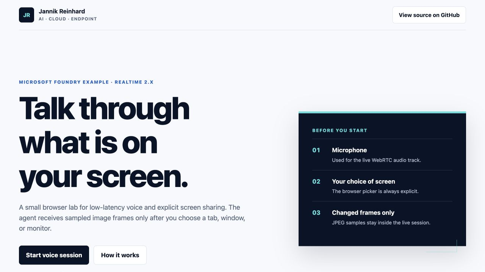
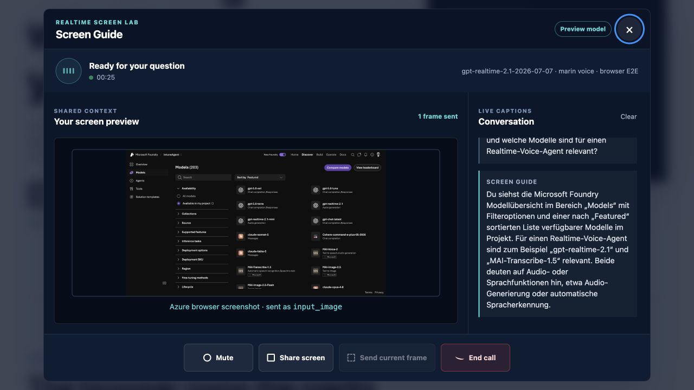
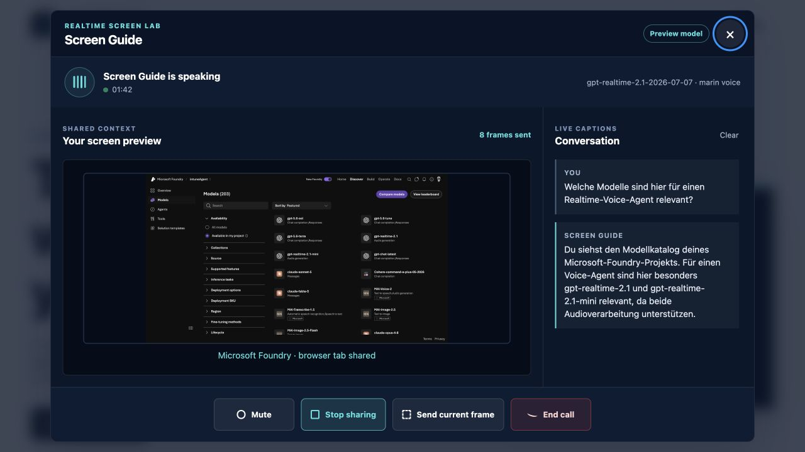

# Realtime Voice and Screen Share Lab

Talk to a Microsoft Foundry Realtime model through WebRTC and explicitly share
a browser tab, application window, or monitor as visual context.

This is a small learning lab, not a production service. It extracts the useful
technical pattern from a larger agent product and keeps only the parts needed to
understand the flow:

- a server-side Microsoft Entra ID credential;
- an ephemeral Realtime client secret;
- browser-to-Azure WebRTC audio;
- a Realtime data channel for events and captions;
- explicit `getDisplayMedia()` consent;
- changed, downscaled JPEG frames sent as `input_image` conversation items;
- high-detail first/manual frames for readable UI text and low-detail automatic updates;
- a visible preview, frame counter, mute control, and transcript.



The browser E2E path created a real WebRTC session, sent a browser-captured
Microsoft Foundry model catalog as one `input_image`, asked a German question,
and received a grounded German answer from the deployed model.



The focused call dialog used during normal voice and screen-sharing sessions:



## Architecture

```text
Browser                         Local FastAPI service               Microsoft Foundry
   |                                      |                                |
   | POST /api/realtime/token             |                                |
   |------------------------------------->| Entra ID token                  |
   |                                      |------------------------------->|
   |                                      | POST /realtime/client_secrets   |
   |                                      |------------------------------->|
   | ephemeral client secret              |                                |
   |<-------------------------------------|                                |
   |                                                                       |
   | WebRTC SDP + microphone audio + data channel                          |
   |---------------------------------------------------------------------->|
   |                                                                       |
   | input_image items from the explicitly selected screen                |
   |---------------------------------------------------------------------->|
```

The browser never receives an Azure API key or a long-lived Entra token. The
ephemeral client secret is created by the local service and is used only for the
WebRTC session.

## Prerequisites

- Python 3.11 or later
- Azure CLI authenticated to the target tenant
- A Microsoft Foundry resource in a supported Realtime region
- A deployment that supports Realtime audio and `input_image`
- The `Cognitive Services User` role on the resource

The tested deployment is:

```text
Model:      gpt-realtime-2.1
Version:    2026-07-07
SKU:        GlobalStandard
Deployment: gpt-realtime-2.1-2026-07-07
```

GPT Realtime 2.x is currently a preview model family. Do not treat this example
as an SLA-backed production design.

## 1. Deploy the model

Confirm model support and quota before creating a deployment. A minimal test
deployment can be created with Azure CLI:

```bash
az cognitiveservices account deployment create \
  --resource-group <resource-group> \
  --name <foundry-resource> \
  --deployment-name gpt-realtime-2.1-2026-07-07 \
  --model-format OpenAI \
  --model-name gpt-realtime-2.1 \
  --model-version 2026-07-07 \
  --sku-name GlobalStandard \
  --sku-capacity 2
```

## 2. Configure the local lab

```bash
cp .env.example .env
```

Set the Foundry resource name and deployment name in `.env`:

```dotenv
AZURE_OPENAI_RESOURCE=YOUR-FOUNDRY-RESOURCE
AZURE_OPENAI_REALTIME_DEPLOYMENT=gpt-realtime-2.1-2026-07-07
REALTIME_VOICE=marin
```

The resource value is a resource name, not a URL. The server constructs the GA
endpoint `https://<resource>.openai.azure.com/openai/v1`.

The service prefers Microsoft Entra ID through `DefaultAzureCredential`. For a
strictly local lab, you can set `AZURE_OPENAI_API_KEY` as a fallback. Keep that
value in the ignored `.env` file, never in browser code or source control.

## 3. Run the page

```bash
python -m venv .venv
source .venv/bin/activate
python -m pip install -r requirements.txt
az login
uvicorn app:app --host 127.0.0.1 --port 8000
```

Open <http://127.0.0.1:8000>.

For a reproducible local browser proof without granting microphone access, open
`http://127.0.0.1:8000/?e2e=1`. On localhost only, this creates a silent WebRTC
audio track and sends the browser-captured Microsoft Foundry model catalog as
an `input_image`. The normal page never uses this path: it requests the real
microphone and the native screen picker.

1. Select **Start voice session** and allow microphone access.
2. Talk to the agent.
3. Select **Share screen** and choose one surface in the browser picker.
4. Ask the agent what it can see.
5. Watch the preview and frame counter.
6. Stop sharing before entering sensitive information.

`localhost` and `127.0.0.1` are secure browser contexts for local media access.
Use HTTPS when you host the page elsewhere.

## How screen sharing works

Screen sharing is not a video track sent to the model. The implementation:

1. Calls `navigator.mediaDevices.getDisplayMedia()` after a user action.
2. Displays the selected stream in the call dialog.
3. Samples a 32×32 grayscale thumbnail every two seconds.
4. Skips the frame when the mean pixel change is below the threshold.
5. Downscales the longest edge to 1280 pixels.
6. Encodes the result as a 68% quality JPEG.
7. Sends first and manually requested frames with `detail: high` for readable UI
   text; automatic changed-frame updates use `detail: low`.
8. Sends the `input_image` conversation item over the Realtime data channel.
9. Stops after 120 frames per call.

The model receives still images, not the full screen-capture video stream. That
keeps the example understandable and gives the UI a precise frame counter.

## Why WebRTC

Microsoft recommends WebRTC for browser-based Realtime audio because it has
lower latency and built-in media handling. WebSockets remain useful for
server-to-server audio or a custom proxy. This lab uses WebRTC for audio and its
data channel for Realtime events plus image items.

## What I reused from Frontier Engine

The implementation was informed by four patterns in Frontier Engine:

- the call is an explicit focused surface with clear connection states;
- screen sharing always has a live preview;
- frames are downscaled, change-detected, and limited;
- screen context is inserted as `input_image`, never described as a continuous
  video feed.

The UI and connection path are intentionally different. This example uses the
JannikReinhard.com visual language and connects the browser directly to Azure
through WebRTC instead of copying Frontier's authenticated application proxy.

## Security boundaries

- The demo server binds to `127.0.0.1` in the documented command.
- The token endpoint accepts only configured browser origins.
- Entra ID credentials remain on the server.
- Client secrets are short lived and returned with `Cache-Control: no-store`.
- The browser picker is the only way to start screen capture.
- Screen frames are kept in memory and are not written to disk by the example.
- No Microsoft Intune or Microsoft Graph write permissions are requested.

For a hosted application, add user authentication, per-user authorization,
rate limiting, audit events, a content-retention policy, abuse controls, HTTPS,
and a restrictive Content Security Policy before exposing the token endpoint.

## Run tests

```bash
pytest -q
```

The tests validate endpoint construction, server-owned session configuration,
the health response, and origin rejection without creating an Azure session.

## Visual preview without media permissions

For documentation screenshots only, append `?preview=call`:

```text
http://127.0.0.1:8000/?preview=call
```

This renders a clearly illustrative call state. It does not request a token,
microphone, or screen capture and must not be used as runtime proof.

## Companion article

The step-by-step article will be available at:

<https://jannikreinhard.com/microsoft-foundry-realtime-voice-screen-share/>
